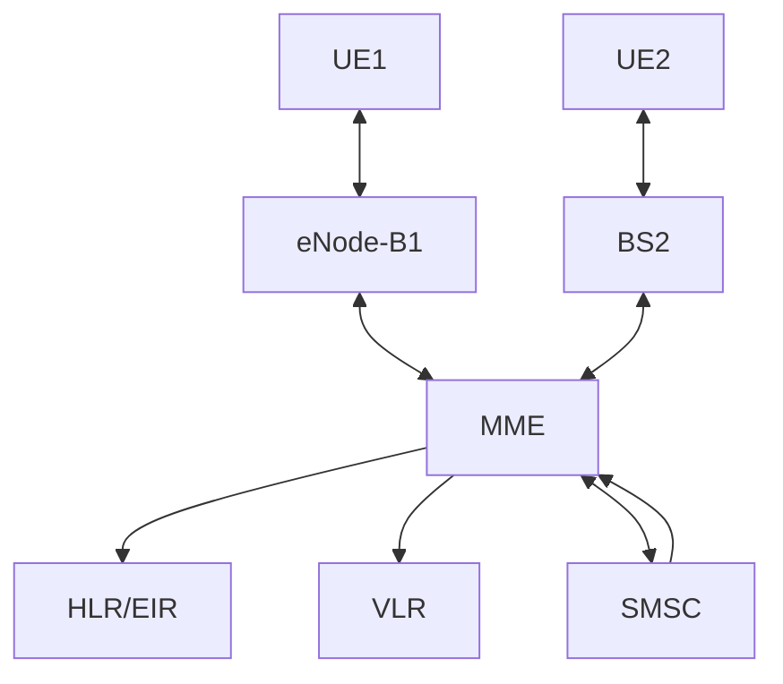

# Консольное многопоточное клиент-серверное приложение TelecomApp

## Описание проекта
Данный проект представляет собой консольное многопоточное клиент-серверное приложение, состоящее из двух исполняемых файлов:
- `TelecomAppClient` - модель пользовательского оборудования (UE, User Equipment)
- `TelecomAppServer` - модель серверной части сети LTE (SimTel), включающей MME, набор базовых станций (eNode-B), SMS-центр и подсистемы HLR(+EIR) и VLR

Приложение поддерживает:
- инициализацию через параметры командной строки и JSON-конфигурацию
- хранение состояния клиентского устройства и сервера
- интерактивное текстовое меню на английском языке
- изменение внутреннего состояния клиентского устройства через команды пользователя
- вычисление сервером расстояния от его позиции до заданной
- клиент-серверный обмен по TCP-сокетам
- бинарный и JSON-протоколы передачи данных
- многопоточную обработка подключений
- имитацию процедуры регистрации UE в сети LTE
- проверку абонентов через HLR(+EIR)
- назначение временного идентификатора M-TMSI
- ведение временного регистра VLR
- привязку зарегистрированных абонентов к обслуживающей базовой станции
- передачу обслуживания (handover) абонента с одной базовой станции на другую при его перемещении в пространстве
- передачу SMS между зарегистрированными абонентами в сети
- временное хранение SMS в SMS-центре (SMSC)
- подтверждение доставки сообщений
- обновление статусов исходящих SMS у отправителя
- отключение UE от сети и освобождение выделенных ресурсов
- логирование работы всех компонентов системы

## Основной функционал приложения-клиента

### Конфигурация
Задаётся через:
1) загрузку параметров только через флаги из CLI
2) загрузку параметров только из JSON-файла, путь к которому передаётся через флаг `--config`/`-k`
3) загрузку параметров из JSON и переопределение значений через CLI (т.е. данным из CLI отдаётся приоритет)

Поддерживаемые параметры:
| Короткий ключ | Длинный ключ | JSON поле | Ожидаемый тип данных |
|----------|----------|----------|-----|
| `-a `| `--ip` | ip | IPv4 |
| `-p` | `--port` | port | uint16_t |
| `-e` | `--imei` | imei | string[15] |
| `-i` | `--imsi` | imsi | string[15] |
| `-l` | `--loc` | loc | array<float,3> (x, y, z) |
| `-k` | `--config` | не задаётся | string |
| `-m` | `--msisdn` | msisdn | string |
| `-b` | `--book` | не задаётся | string |
| `-n` | `--nodes` | string | string |

Порядок задания флагов в CLI не важен.

При задании координат текущего положения через CLI они должны перечисляться через пробел, т.е. в формате: `--loc/-l <x> <y> <z>`.

В приложении считается, что флаг `--nodes`/`-n` не является обязательным для указания (т.е. может быть опущен).

Флаг `--book`/`-b` задаёт путь к файлу c адресной книгой MSISDN потенциальных адресатов.

Если один и тот же флаг в CLI дублируется (например, несколько раз `--port`), то актуальным считается значение из последнего флага этого типа.

**Ограничения данных:**
- Младший байт IPv4-адреса должен находиться в диапазоне [1; 253]
- Номер порта должен быть в диапазоне [1024; 65535] (в соответствии с пользовательскими и динамическими портами по классификации IANA)

### Состояние
Приложение-клиент хранит:
- IP-адрес
- порт
- IMEI (International Mobile Equipment Identity)
- IMSI (International Mobile Subscriber Identity)
- MSISDN (Mobile Subscriber Integrated Services Digital Number)
- текущую позицию (координаты в 3х-мерном пространстве)
- состояние подключения клиента к серверу (active / inactive)
- формат протокола передачи данных (binary / JSON)
- список полученных SMS
- список отправленных SMS с их статусами
- узлы (nodes)

Поле текущей позиции (loc) изменяется внутри программы. Все остальные поля являются неизменяемыми после инициализации.

### Интерактивное меню

Поддерживаемые команды:

| Команда | Описание |
|----------|----------|
| `EXIT` | Завершение работы |
| `ACTIVE <true/false/0/1>` | Изменение состояния приложения |
| `MOVE <x>` | Задание нового значения координате `x` |
| `MOVE <x> <y>` | Задание нового значения координатам `x`, `y` |
| `MOVE <x> <y> <z>` | Задание нового значения координатам `x`, `y`, `z` |
| `PROTOCOL <binary/json>` | Изменение формата передачи данных |
| `SMS <receiverMSISDN> <text>` | Отправка сообщения получателю с номером receiverMSISDN |
| `SMS-SENT` | Просмотр списка исходящих сообщений с указанием их статуса |
| `SMS-RECEIVED` | Просмотр списка входящих сообщений |

При выполнении команды SMS можно вместо ввода MSISDN указывать номер «быстрого» набора через префикс – `@`.

Если клиент успешно зарегистрирован на сервере, то при выполнении команды `MOVE` клиент, кроме обновления значений заданных координат, дополнительно передаёт по указанному формату (binary / json) серверу свою позицию и получает от сервера расстояние между ними.
Для поддержания непрерывности сетевого обслуживания при перемещении клиента может произойти процедура Handover.


Особенности:
- команды регистронезависимы;
- корректно обрабатываются непечатные символы (лишние пробелы и табуляции);
- проверяется корректность команд и аргументов, в случае несоответствия требованиям выводится сообщение об ошибке;
- аргументы команды вводятся сразу после имени команды;
- асинхронность ответов: т.к. сетевой обмен происходит в фоновом потоке, ответы от сервера могут приходить с небольшой задержкой и потому не отображаться сразу после команды, или, наоборот, появляться прямо во время ввода очередной команды

Если текст «наслоился» на строку ввода, это не влияет на работу программы. Вы можете продолжать вводить команду.
Если Вы хотите «очистить» строку и увидеть приглашение к вводу заново - просто нажмите Enter.

- при вводе команды `EXIT` приложение не завершается мгновенно. Главный поток дожидается опустошения очереди сетевых задач (т.е. все отправленные координаты будут доставлены на сервер, а ответы - выведены в консоль).


### Строка статуса
В верхней части меню отображается:
- состояние приложения (active / inactive)
- IMSI устройства
- текущая позиция (x;y;z)
- выбранный протокол передачи данных (binary / json)


## Основной функционал приложения-сервера

Сервер инициализируется через флаги из CLI: 
- портом
- позицией
- файлом с общей конфигурацией имитации оборудования (`epc.json`)

Флаги имеют такой же формат, как и у приложения-клиента, т.е. `-p`/`--port`, `-l`/`--loc` и `-k`/`--config`.

Приложение-сервер работает в многопоточном режиме (2 потока):
1. **Главный поток:** принимает пользовательский ввод через консоль в виде вектора позиции и вычисляет расстояние между своей позицией и заданной, результат выводится в консоль;
2. **Сетевой поток (фоновый):** ожидает подключения клиентов. Для каждого нового клиента создаётся отдельный поток, который обрабатывает полученные от пользователя сетевые пакеты.

Логика передачи вектора аналогична той, что используется в команде `MOVE`, т.е. если передан один аргумент - это `x`, если два - это `х` и `у`, если три - это `x`,`y` и `z`.

Сервер автоматически завершит работу, если к нему не будет подключено ни одного клиента в течение времени, заданного в поле `simtel_ttl_sec` его конфигурации .

## Логирование
Приложение ведёт непрерывную запись событий в лог-файлы. Имя каждого лог-файла содержит идентификатор процесса (PID) соотвествующего приложения. Формат имён: `telecomAppClient_PID<PID>.log` и `telecomAppServer_PID<PID>.log`.
- Для удобства сопоставления лог-файла и приложения, при запуске приложения-сервера и приложения-клиента имя соответствующего лог-файла и PID дублируются в стандартный вывод.

Также ошибки и предупреждения дублируются в стандартный поток ошибок (`std::cerr`). 

Файлы с логами создаются в рабочей директории при запуске приложения (по умолчанию — в папке `build`).

Поддерживаются различные уровни логирования (INFO, WARNING, ERROR, DEBUG). 

Ошибки валидации данных из флагов CLI и JSON-файла при старте работы приложения рассматриваются как критические ошибки (ERROR) и приводят к завершению работы программы.

Во время работы приложения ошибки валидации команд пользователя не приводят к завершению программы, а фиксируются в логах как предупреждения (WARNING).

## Архитектура проекта

### Архитектура LTE-модели:




### Структура проекта:
```bash
├── APP
│   ├── app
│   │   ├── App.h | .cpp 
│   │   ├── AppParams.h | .cpp
│   │   ├── NetworkTask.h
│   │   ├── SmsStorage.h | .cpp
│   │   └── StartupParams.h | .cpp
│   ├── CommandHandler
│   │   ├── CommandActive.h | .cpp
│   │   ├── CommandExit.h | .cpp
│   │   ├── CommandHandler.h | .cpp
│   │   ├── CommandInterface.h
│   │   ├── CommandMove.h | .cpp
│   │   ├── CommandProtocol.h | .cpp
│   │   ├── CommandReceivedSms.h | .cpp
│   │   ├── CommandSentSms.h | .cpp
│   │   ├── CommandSms.h | .cpp
│   │   └── SingleArgCommand.h | .cpp
│   └── main.cpp
├── COMMON
│   ├── logging
│   │   ├── FileLogger.h | .cpp
│   │   ├── Logger.h | .cpp
│   │   └── LoggerInterface.h
│   ├── ConsoleProvider.h | .cpp
│   ├── constants.h
│   ├── ThreadSafeQueue.h
│   ├── networkUtils.h | .cpp
│   ├── parserUtils.h | .cpp
│   ├── utils.h | .cpp
│   └── validationUtils.h | .cpp
├── CORE
│   ├── ClientSocket.h | .cpp
│   ├── entitiesConfigs
│   │   ├── AddressBookEntry.h
│   │   ├── BaseStationConfig.h
│   │   ├── EpcConfig.h
│   │   ├── MmeConfig.h
│   │   ├── SmsCenterConfig.h
│   │   └── SubscriberRecord.h | .cpp
│   ├── network
│   │   ├── BinarySerializer.h | .cpp
│   │   ├── JsonSerializer.h | .cpp
│   │   ├── NetworkMessages.h | .cpp
│   │   ├── SerializerFactory.h
│   │   └── SerializerInterface.h
│   ├── NetworkAddress.h | .cpp
│   ├── PacketTransporter.h | .cpp
│   ├── ServerSocket.h | .cpp
│   └── types.h | .cpp
├── data
│   ├── config([1-9]|10).json    # config1.json,..., config10.json
│   ├── config.json
│   ├── epc.json
│   ├── hlrEir.json
│   ├── mme.json
│   ├── nodes.json
│   └── ue([1-4]).json    # ue1.json,..., ue4.json
├── SERVER
│   ├── entities
│   │   ├── BaseStation.h | .cpp
│   │   ├── ClientContext.h
│   │   ├── hlrAndEir
│   │   │   ├── HlrEirInterface.h | .cpp
│   │   │   └── JsonHlrEir.h | .cpp
│   │   ├── SmsCenter.h | .cpp
│   │   └── MobilityManagmentEntity.h | .cpp
│   ├── mainServer.cpp
│   └── ServerApp.h | .cpp
├── runClients.sh
├── CMakeLists.txt
├── README.md
└── tests
    ├── AppTests.cpp
    ├── CommandsTests.cpp
    ├── NetworkAddressTests.cpp
    ├── ParserTests.cpp
    ├── SilentLogger.h
    ├── testMain.cpp
    ├── testsHelper.cpp
    ├── testsHelper.h
    ├── UtilsTests.cpp
    └── ValidatorsTests.cpp
```
### Основные компоненты:
- **`App`** – приложение-клиент, управляющее состоянием устройства и обработкой пользовательских команд
- **`StartupParams`** – объект для передачи данных при запуске клиента
- **`AppConfig`** – объект, хранящий конфигурацию (неизменяемые данные) приложения
- **`AppState`** – объект, хранящий состояние (изменяемые данные) приложения
- **`CommandHandler`** – обработка пользовательских команд
- **`ServerApp`** – приложение-сервер
- **`NetworkAddress`** – класс сетевого адреса
- **`BaseStationConfig`** – объект, хранящий конфигурацию базовой станции
- **`EpcConfig`** – объект, хранящий общую конфигурацию имитации оборудования 
- **`AddressBookEntry`** – объект, хранящий адресную книгу с MSISDN потенциальных адресатов
- **`SmsCenterConfig`** – объект, хранящий конфигурацию  центра управления и временного хранения сообщений
- **`MmeConfig`** – объект, хранящий конфигурацию узла управления мобильностью сети сотовой связи
- **`SubscriberRecord`** – объект, хранящий данные из Home Location Register (БД оператора связи с информацией об абоненте мобильной сети) и Equipment Identity Register (регистр абонентского оборудования) об абоненте
- **`BaseStation (eNode-B)`** – класс, моделирующий работу базовой станции LTE (отвечает за обслуживание зарегистрированных UE, хранение контекста подключённых абонентов и взаимодействие с MME)
- **`JsonHlrEir`** – реализация подсистемы HLR(+EIR) на основе JSON-хранилища. Используется для проверки существования абонентов, а также хранения информации о текущем состоянии абонентов
- **`MobilityManagmentEntity`** – класс, моделирующий работу узла управления мобильностью сети сотовой связи (реализует процедуры регистрации UE, проверку абонентов через HLR(+EIR), назначение временных идентификаторов M-TMSI, ведение временного регистра VLR, выбор обслуживающей базовой станции и маршрутизацию сетевых операций)
- **`SmsCenter`** - класс, моделирующий работу центра управления и временного хранения сообщений, реализует механизм TTL (Time To Live) - удаление сообщений, которые не удалось доставить за отведенное время
- **`SmsStorage`** - класс, хранящий полученные и отправленный сообщения конкретным клиентом
- **`NetworkTask`** - описание сетевых команд, обрабатываемых клиентом
- **`NetworkMessages`** - описание сетевых пакетов
- **`ConsoleProvider`** - класс для синхронизации вывода в консоль из разных потоков
- **`types`** – пользовательские типы данных, описывающие доменную модель (IPv4, IMSI, IMEI, Nodes, Port, Point3D, Protocol)
- **`ThreadSafeQueue`**- потокобезопасная очередь
- **`utils`** – вспомогательные функции
- **`Logger`** – объект, отвечающий за логирование работы приложения
- **`constants`** - константы, используемые для валидации данных

### Сетевое взаимодействие:
- **`ClientSocket`** – обёртка над TCP-клиентским сокетом
- **`ServerSocket`** – обёртка над TCP-серверным сокетом
- **`PacketTransporter`** – компонент прикладного сетевого протокола обмена данными между клиентом и сервером
- **`JsonSerializer`**, **`BinarySerializer`** – преобразование данных в сетевой формат и обратно

### Ограничения текущей реализации:

- HLR(+EIR) реализован поверх JSON-хранилища;
- VLR хранится только в оперативной памяти;
- отсутствует тарификация услуг связи;
- не реализованы процедуры аутентификации и шифрования.

## Сборка проекта
Приложение разрабатывается на операционной системе Alt Linux.
### Требования
- C++20
- CMake ≥ 3.14
- Компилятор: g++ ≥ 13

### Зависимости
| Библиотека | Версия | Тип подключения |
|------------|--------|-----------------|
| `nlohmann/json` | 3.12.0 | Автоматическое через FetchContent при запуске `cmake ..` |
| `GoogleTest` | 1.12.x | Автоматическое через FetchContent при запуске `cmake ..` |

### Сборка проекта
В корневой директории проекта выполнить:
```bash
mkdir build
cd build
cmake ..
# Для сборки в однопоточном режиме:
cmake --build .
# Для сборки в многопоточном режиме:
# N - целое число потоков, используемых при сборке
cmake --build . -jN
```

### Пример ue.json
```json
{
    "ip": "127.0.0.1",
    "port": 7777,
    "imei": "158863118273320",
    "imsi": "12345601112233",
    "msisdn": "89991112233",
    "loc": [-34.2, 0, 0],
    "address_book_path" : "../data/addressBook.json"
}
```

### Пример epc.json
```json
{
  "simtel_ttl": 120,
  "hlrEir":
  {
    "format": "JSON",
    "provider": "file",
    "path": "../data/hlrEir.json"
  },
  "nodes_file": "../data/nodes.json",
  "mme_config": "../data/mme.json",
  "smsc_config": "../data/smsc.json"
}
```

### Пример hlrEir.json
```json
[
  {
    "imsi": "12345601112233",
    "imei": "158863118273320",
    "msisdn": "89991112233",
    "status": "inactive"
  },
  {
    "imsi": "12345603334455",
    "imei": "325314891006270",
    "msisdn": "89993334455",
    "status": "inactive"
  },
  {
    "imsi": "12345605556677",
    "imei": "891352784123650",
    "msisdn": "89995556677",
    "status": "inactive"
  },
  {
    "imsi": "12345607778899",
    "imei": "891355118756160",
    "msisdn": "89997778899",
    "status": "inactive"
  }
]
```

### Пример mme.json
```json
[
  {
    "id": 1,
    "maximum_records_in_vlr": 100
  }
]
```

### Пример nodes.json
```json
{
  "base_stations": [
    {
      "id": 1,
      "mme_id": 1,
      "position": [-100, 0, 0],
      "coverage_radius": 120.0,
      "max_supported_connections": 10,
      "buffer_bytes_size_per_connection": 1024
    },
    {
      "id": 2,
      "mme_id": 1,
      "position": [100, 0, 0],
      "coverage_radius": 120.0,
      "max_supported_connections": 10,
      "buffer_bytes_size_per_connection": 1024
    }
  ]
}
```

### Пример addressBook.json
```json
[
  {
    "imsi": "12345601112233",
    "imei": "158863118273320",
    "msisdn": "89991112233",
    "status": "inactive"
  },
  {
    "imsi": "12345603334455",
    "imei": "325314891006270",
    "msisdn": "89993334455",
    "status": "inactive"
  },
  {
    "imsi": "12345605556677",
    "imei": "891352784123650",
    "msisdn": "89995556677",
    "status": "inactive"
  },
  {
    "imsi": "12345607778899",
    "imei": "891355118756160",
    "msisdn": "89997778899",
    "status": "inactive"
  },
  {
    "imei": "490154203237518",
    "imsi": "404685505601234",
    "msisdn": "88120001122",
    "status": "inactive"
  }
]
```

### Пример smsc.json
```json
{
    "max_text_length": 100,
    "max_buffer_count": 160,
    "sms_ttl_ms": 30000
}
```

### Примеры запуска

#### Запуск клиента
Чтение параметров только из CLI:
```bash
./TelecomAppClient --ip 127.0.0.1 --port 7777 --imei 490154203237518 --imsi 404685505601234 --msisdn 88120001122 --loc 1.6 -20.3 0 --nodes nodeA,nodeB --book ../data/addressBook.json
```

Чтение параметров только из JSON файла:
```bash
./TelecomAppClient --config ../data/config.json --nodes nodeA,nodeB
```

С переопределением некоторых параметров из JSON файла через флаги в CLI:
```bash
./TelecomAppClient --config ../data/config.json --port 7777 --imei 490154203237518 --imsi 404685505601234 --nodes nodeA,nodeB --loc 1.6 -20.3 0
```

#### Автоматический запуск нескольких приложений-клиентов (через bash-скрипт)
Для удобного тестирования многопоточного сервера предусмотрен скрипт `runClients.sh`, позволяющий запустить сразу несколько клиентов в отдельных окнах терминала.
- Максимальное количество клиентов, которое можно запустить через скрипт равняется 4 (при необходимости, увеличить это число можно изменив переменную `MAX_CLIENTS` в скрипте, но тогда у Вас должно быть необходимое соответствующее количество конфигурационных файлов в папке `/data`).

Скрипт автоматически подстраивается под используемый эмулятор терминала (gnome-terminal, konsole, xfce4-terminal и др.).
```sh
# Сделать скрипт исполняемым (нужно выполнить один раз)
cd .. # т.е. надо переместиться в корневую директорию
chmod +x runClients.sh

# Запуск 3 клиентов по умолчанию
./runClients.sh

# Запуск N клиентов (от 1 до 4), тут N = 2
./runClients.sh 2
```

Если вдруг скрипт выведет ошибку `Error: no supported terminal emulator found (tried gnome-terminal, konsole, xfce4-terminal, etc.)`, то выполнить запуск клиентов руками с помощью команд ниже (каждую команду нужно вводить в новом терминале, находясь в папке `./build`):
```sh
./TelecomAppClient --config ../data/ue1.json --nodes node1
./TelecomAppClient --config ../data/ue2.json --nodes node2
./TelecomAppClient --config ../data/ue3.json --nodes node3
./TelecomAppClient --config ../data/ue4.json --nodes node4
```

#### Запуск сервера
```bash
cd build # нужно выполнять, только если Вы в корневой директории

./TelecomAppServer --port 7777 --loc -3.14 5.45 13.335 --config ../data/epc.json
```

#### Запуск тестов
```bash
cd build # нужно выполнять, только если Вы в корневой директории

./TelecomAppTests
```